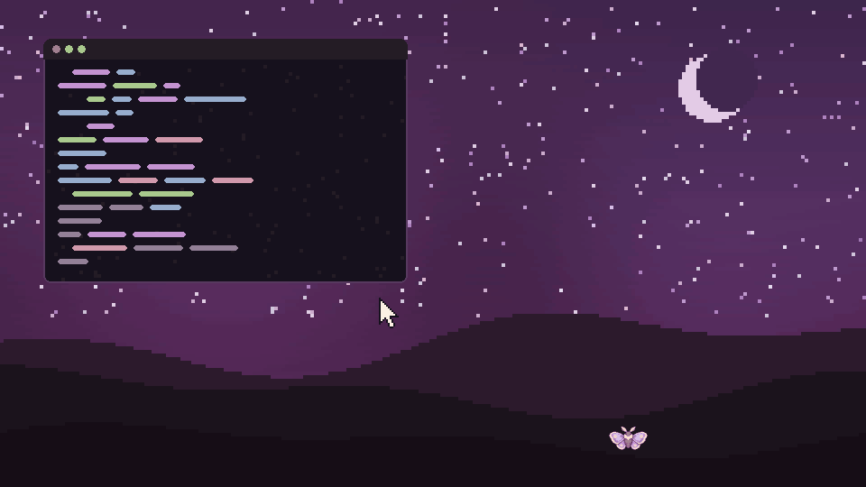
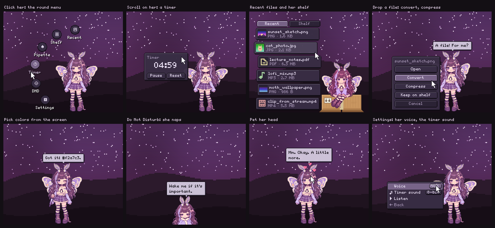
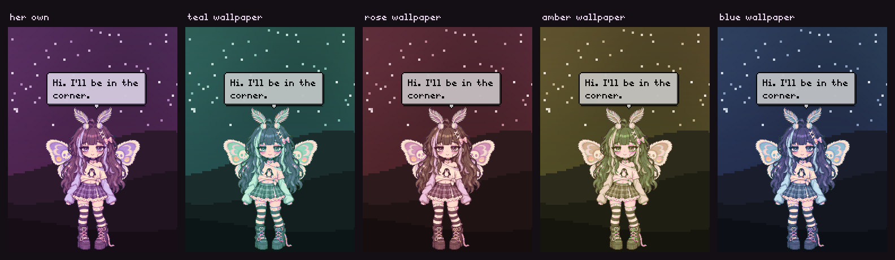
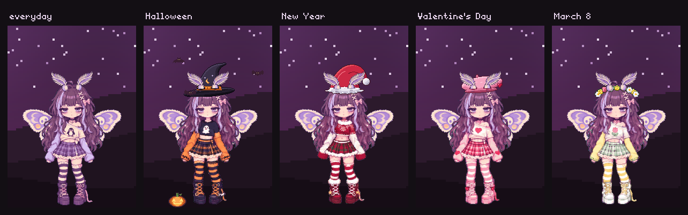

<div align="center">

# Yumi

**A sleepy pixel-art moth girl who lives at the bottom of your screen.**

She hides under the edge while you work, pops out when you need her, keeps your recent files,
runs timers, picks colors, converts files, takes your wallpaper's colors, and naps when you
are away.



English · [Русский](README.ru.md)

</div>

---

## What she can do



- **Lives at the bottom edge.** While she hides, a tiny moth flutters where she sleeps. Touch it
  (or press your hotkey) and she pops out.
- **Round menu.** Click her: Recent, Shelf, Pipette, Timer, Do Not Disturb, Settings, plus up to
  four buttons of your own.
- **Recent files and a shelf.** A box lands under her and your latest files spill out. Click to
  open, drag a card into any app, keep favourites on her shelf.
- **Convert and compress.** Drop files on her: PNG ↔ JPG ↔ WebP, video → MP4 / WebM / GIF / MP3,
  audio → MP3 / OGG / FLAC…, or make them smaller. Progress shows above her head.
- **Timer.** Scroll on her to set it, click the digits to type the time. A soft bell plays twice
  when it ends.
- **Color picker.** Click anywhere on the screen; the hex code is copied and kept in her history.
- **Do Not Disturb.** She naps in a blanket and switches your notification daemon to DND
  (swaync, mako, dunst).
- **Takes your wallpaper's colors** (hair, eyes, clothes, wings, her bubbles) and changes with it.
- **Feels alive.** Her eyes follow the pointer, she blushes when you pet her head (sparkles
  trail your pointer), reacts to the
  charger, Wi-Fi, downloads, screenshots and music, dozes off when you are away, and reminds you
  to drink water if you ask her to.
- **Seasonal outfits** with hats she made holes in for her antennae.
- **Several screens.** Carry her over to another one.
- **Her voice.** Her words type out with little 8-bit blips, like a game character talking
  (Settings → Sound → Voice: volume or off).
- English and Russian, picked from your system language.





## Where she lives

Yumi needs a Wayland compositor with **wlr-layer-shell**:

| Works | Not yet |
| --- | --- |
| sway, Hyprland, niri, river, Wayfire, labwc, KDE Plasma 6, COSMIC, other wlroots-based ones | GNOME (Mutter has no layer-shell), X11 sessions, Windows, macOS |

Everything except the window itself is optional: when a tool is missing she simply does not do
that one thing, and the settings say "not available yet" where it matters.

## Install

### 1. Dependencies

| Distro | Command |
| --- | --- |
| Arch, Manjaro, EndeavourOS | `sudo pacman -S --needed python-gobject python-cairo gtk4 gtk4-layer-shell` |
| Void | `sudo xbps-install -S python3-gobject python3-cairo gtk4 gtk4-layer-shell` |
| Fedora | `sudo dnf install python3-gobject python3-cairo gtk4 gtk4-layer-shell` |
| openSUSE Tumbleweed | `sudo zypper in python3-gobject python3-gobject-cairo typelib-1_0-Gtk-4_0 typelib-1_0-Gtk4LayerShell-1_0` |
| NixOS | no step needed, see below (`nix run github:lamex30/yumi`) |
| Debian 13+, Ubuntu (when the package exists) | `sudo apt install python3-gi python3-gi-cairo gir1.2-gtk-4.0 gir1.2-gtk4layershell-1.0` |

Optional, for the extras (install what you like):

| Tool | For |
| --- | --- |
| `ffmpeg` | converting and compressing video, audio and GIFs |
| `imagemagick`, `pngquant`, `oxipng`, `jpegoptim` | converting and compressing images |
| `hyprpicker`, or `grim` + `slurp` | the color picker on wlroots compositors (KDE and COSMIC use the desktop portal) |
| `wl-clipboard` | copying picked colors (falls back to GTK's clipboard) |
| `swayidle` | dozing off when you are away |
| `playerctl` | reacting to music |
| `networkmanager` (`nmcli`) | Wi-Fi reactions |
| `swaync`, `mako` or `dunst` | Do Not Disturb |
| `pipewire` (`pw-play`), `paplay`, `aplay` or `ffplay` | the timer bell |

### 2. Yumi herself

```sh
git clone https://github.com/lamex30/yumi
cd yumi
./install.sh          # into ~/.local; for everyone: sudo PREFIX=/usr/local ./install.sh
yumi
```

You can also run her straight from the folder: `./bin/yumi`. `./install.sh --uninstall` removes
her again. Packagers: `PREFIX=/usr DESTDIR="$pkgdir" ./install.sh`; there is a `PKGBUILD` and a
Void `template` in [`packaging/`](packaging).

**NixOS:** `nix run github:lamex30/yumi` tries her out; to install, add the flake as an input and
put `inputs.yumi.packages.${system}.default` in `environment.systemPackages` (or use
`overlays.default` for `pkgs.yumi-moth`). The dependencies and gtk4-layer-shell are wired in.

### 3. Start her with your session and give her a hotkey

`yumi` starts her in the background: you can close the terminal, she stays. `yumi --toggle` pops
her out, hides her or wakes her up. Other flags: `--pipette`, `--recent`, `--sleep` (Do Not
Disturb), `--home`, `--monitor`, `--quit`, and `--foreground` to keep her attached to the
terminal (handy for debugging).

<details open>
<summary><b>sway</b> (<code>~/.config/sway/config</code>)</summary>

```
exec yumi
bindsym $mod+z exec yumi --toggle
bindsym $mod+p exec yumi --pipette
```
</details>

<details>
<summary><b>Hyprland</b> (<code>~/.config/hypr/hyprland.conf</code>)</summary>

```
exec-once = yumi
bind = SUPER, Z, exec, yumi --toggle
bind = SUPER, P, exec, yumi --pipette
```
</details>

<details>
<summary><b>niri</b> (<code>~/.config/niri/config.kdl</code>)</summary>

```kdl
spawn-at-startup "yumi"
binds {
    Mod+Z { spawn "yumi" "--toggle"; }
    Mod+P { spawn "yumi" "--pipette"; }
}
```
</details>

<details>
<summary><b>river</b> (<code>~/.config/river/init</code>)</summary>

```sh
riverctl spawn yumi
riverctl map normal Super Z spawn 'yumi --toggle'
riverctl map normal Super P spawn 'yumi --pipette'
```
</details>

<details>
<summary><b>Wayfire</b>, <b>labwc</b></summary>

Wayfire: `[autostart] yumi = yumi` and a `[command]` binding to `yumi --toggle`.
labwc: add `yumi &` to `~/.config/labwc/autostart` and a `<keybind>` running `yumi --toggle` in
`rc.xml`.
</details>

<details>
<summary><b>KDE Plasma</b>, <b>COSMIC</b></summary>

Add **Yumi** to the autostart apps in the system settings, then add a custom shortcut that runs
`yumi --toggle`.
</details>

## Using her

| Do | She does |
| --- | --- |
| Hover the moth | pops out; the moth hides behind her |
| Click her | a round menu: Recent, Shelf, Pipette, Timer, DND, Settings |
| Recent / Shelf | a box lands under her, files spill out next to it |
| Click a card / drag it out | opens it / drops it into any app |
| Drag a card onto her, or right-click it | Open, Convert, Compress, Keep on shelf |
| Drop files on her (or on the moth) | asks what to do: convert, compress, keep on the shelf |
| Scroll over her | sets a timer; it starts a moment after you stop scrolling |
| Click the timer digits | type the time: digits overwrite under the cursor, Enter applies, Esc cancels |
| Press and hold, then drag | picks her up by the scruff |
| Let go near the bottom edge | she hides there, anywhere along the edge |
| Let go anywhere else | she floats there, flapping, until you move her |
| Middle-click her (or Settings → Her → Stay out) | she stops hiding; again to let her hide |
| Double-click her | she goes back to the bottom-right corner |
| Stroke her head (move the pointer back and forth over it) | she blushes; hearts, sparkles behind the pointer |
| DND | Do Not Disturb on; she naps in a blanket and stays quiet |

Settings come in groups: **Her** (stay out, system reactions, idle chatter, napping when you
are away, health breaks every 20 / 30 / 45 / 60 min: water, eyes, stretch), **Sound** (her
voice volume, the timer sound: her bell or any audio file), **Look** (wallpaper colors or a
color by hand, outfit, which screen she lives on) and **Language**. The first-run tour can be
replayed from there too.

## Her colors

She takes the hue of your wallpaper and changes when it changes. She finds it by herself in:

- **wallpaper daemons:** awww / swww, swaybg, hyprpaper, wpaperd;
- **configs:** waypaper, azote, KDE Plasma, COSMIC, pywal's cache;
- **a palette file** your own theming script writes: `~/.config/yumi/palette.json`, either just
  `{"hue": 0.47}` (0…1) or a full palette with `bg`, `surface`, `fg`, `accent`… for her bubbles too.
  A `~/.config/pastel-rice/palette.json` is read as well.

If nothing is found, *Wallpaper colors* says "not available yet" and you pick a color by hand in
the settings.

## Her own buttons

Copy [`actions.example.json`](actions.example.json) to `~/.config/yumi/actions.json` (up to 4).
Each entry becomes a round button in her menu:

```json
[
  {"label": "Terminal", "label_ru": "Терминал", "icon": "gear", "command": "foot"},
  {"label": "Play / pause", "label_ru": "Пауза", "icon": "play", "command": "playerctl play-pause"}
]
```

Icons: `convert compress star image video audio doc archive other gear home box shelf note play
clock drop dnd`. Commands run with `sh -c`.

## Outfits

Settings → Look → Outfit: **auto** follows the calendar (Halloween Oct 24 – Nov 2, New Year Dec 15 –
Jan 10, Valentine's Day Feb 12–15, March 8 Mar 6–9), or pick one, or **none**.

An outfit is a folder in `sprites/outfits/<name>/`. Any PNG with the same path and size as a
normal sprite (`body.png`, `held/held0.png`, `sit/body0.png`, `hover/n0.png`…) replaces it.
`outfit.json` adds the rest:

```json
{
  "name": "Halloween",
  "hat": {"img": "hat.png", "front": "hat_front.png", "x": 13, "y": -32},
  "overlays": [{"img": "pumpkin.png", "anchor": "foot", "side": "left", "dx": -6, "dy": 0}],
  "fliers": {"img": "bat.png", "fw": 24, "frames": 2, "count": 3},
  "keep": ["#e8792a"]
}
```

`hat` is drawn under her antennae and `front` (the lips of the antenna slits) over them; `x`, `y`
are relative to her body. `keep` lists colors that stay the same on any wallpaper (a red sweater,
unlike her hair).

## Files

| Path | What |
| --- | --- |
| `~/.config/yumi/settings.json` | settings |
| `~/.config/yumi/actions.json` | your round buttons |
| `~/.config/yumi/palette.json` | optional colors from your theming script |
| `~/.local/state/yumi/state.json` | where she sits, her shelf, picked colors |
| `~/.local/state/yumi/yumi.log` | what she printed (errors go here when she runs in the background) |

`YUMI_SCALE=2 yumi` draws her twice as big (integer pixel scale).

## Troubleshooting

- **`gtk4-layer-shell is not installed`**: install it (see the table above). If it lives
  somewhere unusual, point to it: `YUMI_LAYER_SHELL_LIB=/path/to/libgtk4-layer-shell.so.0 yumi`.
- **"this desktop has no wlr-layer-shell"**: you are on GNOME or X11; those are not supported yet.
- **Wallpaper colors say "not available yet"**: your wallpaper tool is not one she knows. Write
  the hue to `~/.config/yumi/palette.json`, or open an issue saying which tool you use.
- **She does not appear**: run `yumi --foreground` to see what she says, or look into
  `~/.local/state/yumi/yumi.log`.
- **She does not nap when you are away**: install `swayidle`. If your compositor lacks the idle
  protocol, the setting turns into "not available yet".

## Under the hood

Python, GTK 4 and gtk4-layer-shell. One transparent overlay per screen; only what she draws
catches the pointer.

- `moth_girl.py`: the overlay window; draws, forwards input, runs her requests
- `yumi/brain.py`: all of her behaviour, pure Python (draw ops out, no GTK)
- `yumi/extras.py`: gaze, petting, napping, health breaks, tour, outfits, custom buttons
- `yumi/phrases.py`: her lines in English and Russian
- `yumi/voice.py`: her 8-bit voice
- `yumi/jobs.py`: convert / compress commands and the job queue
- `yumi/files.py`: recent files, downloads, screenshots
- `yumi/system.py`: power, Wi-Fi, Do Not Disturb, music, idle, color picker
- `yumi/wallpaper.py`: finding the wallpaper and its color
- `yumi/sprites.py`: sprite metadata, outfits, the wallpaper recolor
- `sprites/`: the pixel art (body rig, poses, faces, the moth, outfits)

## License

[MIT](LICENSE)
