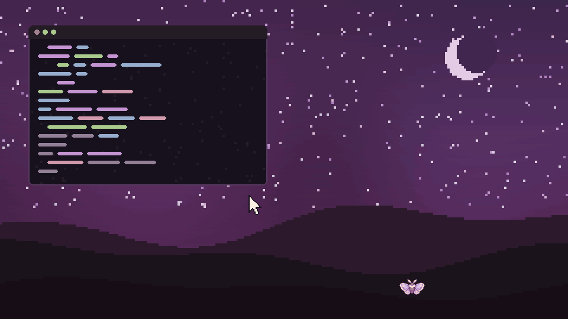
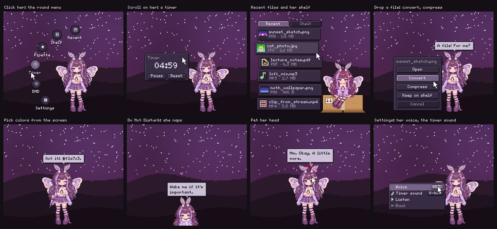
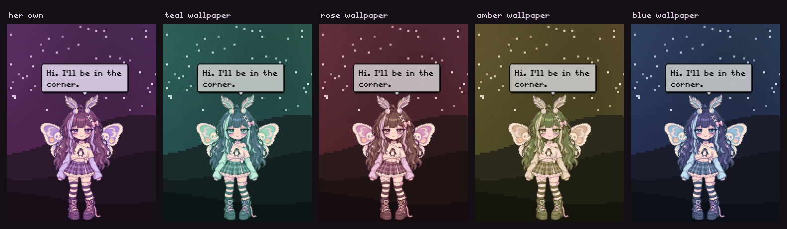
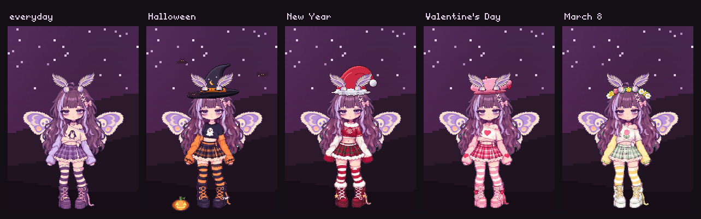
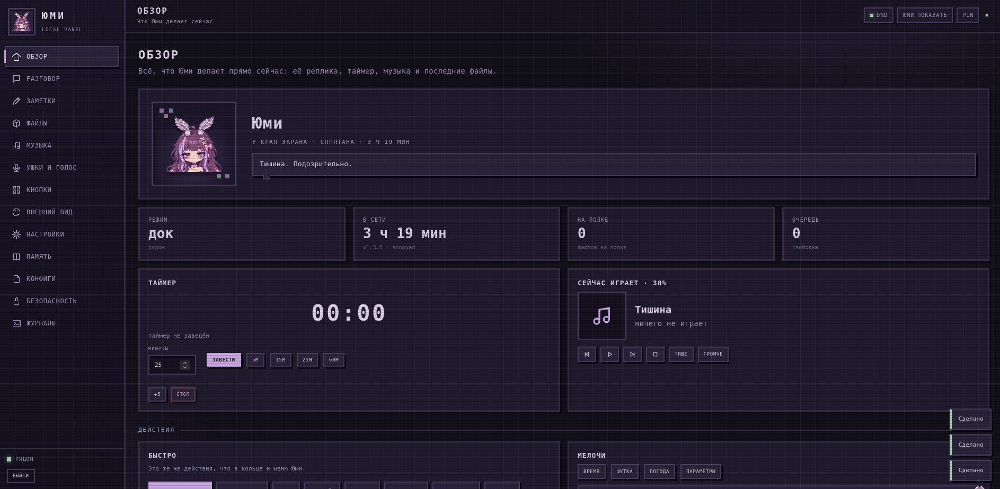
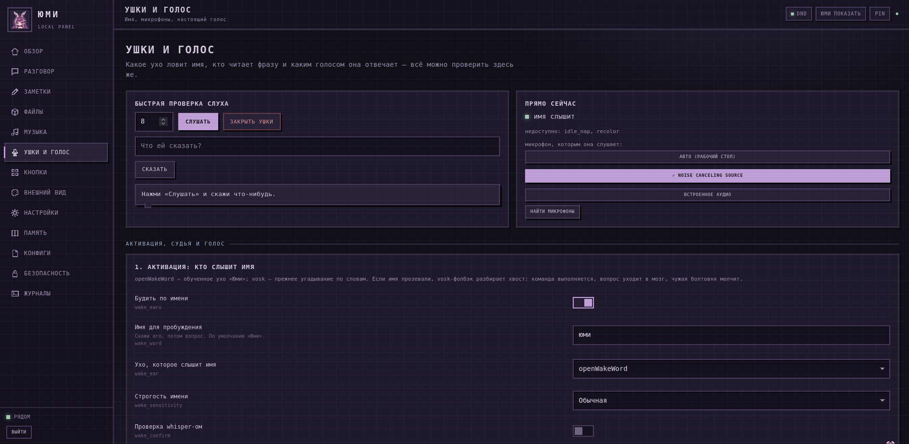
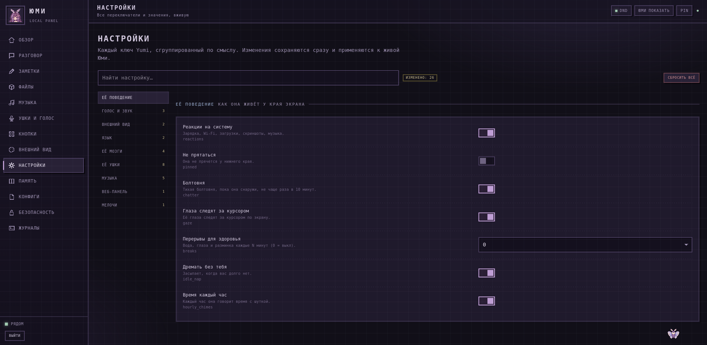

<div align="center">

# Yumi

**A sleepy pixel-art moth girl who lives at the bottom of your screen.**

She hides under the edge while you work, pops out when you need her, keeps your recent files,
runs timers, picks colors, converts files, takes your wallpaper's colors, and naps when you
are away.



English · [Русский](README.ru.md)

</div>

---

## What she can do



- **Lives at the bottom edge.** While she hides, a tiny moth flutters where she sleeps. Touch it
  (or press your hotkey) and she pops out.
- **Round menu.** Click her: Recent, Shelf, Pipette, Timer, Joke, Do Not Disturb, Settings, plus buttons
  of your own. Rearrange them, switch them off or add new ones in Settings → Buttons.
- **Recent files and a shelf.** A box lands under her and your latest files spill out. Click to
  open, drag a card into any app, keep favourites on her shelf.
- **Convert and compress.** Drop files on her: PNG ↔ JPG ↔ WebP, video → MP4 / WebM / GIF / MP3,
  audio → MP3 / OGG / FLAC…, or make them smaller. Progress shows above her head.
- **Timer.** Scroll on her to set it, click the digits to type the time. A soft bell plays twice
  when it ends.
- **Color picker.** Click anywhere on the screen; the hex code is copied and kept in her history.
- **Do Not Disturb.** She naps in a blanket and switches your notification daemon to DND
  (KDE Plasma, swaync, mako, dunst).
- **Takes your wallpaper's colors** (hair, eyes, clothes, wings, her bubbles) and changes with it.
- **Feels alive.** Her eyes follow the pointer, she blushes when you pet her head (sparkles
  trail your pointer), reacts to the
  charger, Wi-Fi, downloads, screenshots and music, dozes off when you are away, and reminds you
  to drink water if you ask her to.
- **Seasonal outfits** with hats she made holes in for her antennae.
- **Several screens.** Carry her over to another one.
- **Her voice.** Her words type out with little 8-bit blips, like a game character talking
  (Settings → Sound → Voice: volume or off) — or she can speak out loud with a real offline
  voice ([Silero](https://github.com/snakers4/silero-models), see "Her real voice" below).
- **She listens and answers.** The mic button on her ring: a local offline Vosk hears your
  phrase (the microphone is picked in the settings), a local Ollama answers it (the model is
  picked in the settings), she says the answer
  out loud — see "She listens and answers" below. She also wakes to her name: say «Yumi» and
  she is listening at once. Ask «what time is it» or «what's the weather» and she answers
  herself: the clock is always at hand, and the weather is one small peek at [wttr.in](https://wttr.in)
  (with a place name she looks there instead of out of her own window). The weather comes
  for today («юми погода в ялте»), for tomorrow («юми погода на завтра в ялте») and for
  the whole week («юми погода на неделю»); tomorrow and the week she peeks at
  [Open-Meteo](https://open-meteo.com). Her own city can be written into
  `~/.config/yumi/settings.json` as `"weather_city": "Yalta"` — then «юми погода» looks
  there (the default is «Anapa», while `""` looks wherever the computer stands).
  Ask «кто играет» or «что за трек» («who plays», «what's playing») and she names the artist
  and the track that is sounding — from any MPRIS player (vlc, spotify, a browser) or her own library.
  Say «включи песню …», «включи что-нибудь» or «включи исполнителя …» and she finds it and plays it:
  from Jellyfin when you are home, from her own folders when you are not.
- English and Russian, picked from your system language.
- **Browser panel** — open Yumi in your browser and manage her from any tab on your computer: settings, buttons, music, memory, notes, files, voice and more. See “The browser panel” below. <kbd>yumi --web</kbd>





## Where she lives

Yumi needs a Wayland compositor with **wlr-layer-shell**, or an X11 session with a compositor:

| Works | Not yet |
| --- | --- |
| sway, Hyprland, niri, river, Wayfire, labwc, KDE Plasma 6, COSMIC, other wlroots-based ones; X11 with compositing on (Xfce, Cinnamon, MATE, i3 / bspwm / Openbox + picom) | GNOME (Mutter has no layer-shell), Windows, macOS |

Everything except the window itself is optional: when a tool is missing she simply does not do
that one thing, and the settings say "not available yet" where it matters.

## Install

### 1. Dependencies

| Distro | Command |
| --- | --- |
| Arch, CachyOS, EndeavourOS | `sudo pacman -S --needed python-gobject python-cairo gtk4 gtk4-layer-shell` |
| Void | `sudo xbps-install -S python3-gobject python3-cairo gtk4 gtk4-layer-shell` |
| Fedora | `sudo dnf install python3-gobject python3-cairo gtk4 gtk4-layer-shell` |
| openSUSE Tumbleweed | `sudo zypper in python3-gobject python3-gobject-cairo typelib-1_0-Gtk-4_0 typelib-1_0-Gtk4LayerShell-1_0` |
| NixOS | no step needed, see below (`nix run github:lamex30/yumi`) |
| Debian 13+, Ubuntu (when the package exists) | `sudo apt install python3-gi python3-gi-cairo gir1.2-gtk-4.0 gir1.2-gtk4layershell-1.0` |

Optional, for the extras (install what you like):

| Tool | For |
| --- | --- |
| `ffmpeg` | converting and compressing video, audio and GIFs |
| `imagemagick`, `pngquant`, `oxipng`, `jpegoptim` | converting and compressing images |
| `hyprpicker`, or `grim` + `slurp` | the color picker on wlroots compositors (KDE and COSMIC use the desktop portal) |
| `wl-clipboard` | copying picked colors (falls back to GTK's clipboard) |
| `swayidle` | dozing off when you are away |
| `playerctl` | reacting to music |
| `networkmanager` (`nmcli`) | Wi-Fi reactions |
| `swaync`, `mako` or `dunst` | Do Not Disturb (KDE Plasma needs nothing extra) |
| `pipewire` (`pw-play`), `paplay`, `aplay` or `ffplay` | the timer bell |
| `tools/tts_setup.sh` (a venv with torch, ~450 MB) | her real voice: a local Silero TTS |
| `tools/stt_setup.sh` (a small venv with vosk) | her ears: local speech recognition |
| `tools/intents_setup.sh` (a ~20 MB model off the releases page, or a venv with torch to teach one anew) | her tiny mind for the voice commands: the rephrasings the sayings miss |

### 2. Yumi herself

```sh
git clone https://github.com/lamex30/yumi
cd yumi
./install.sh          # into ~/.local; for everyone: sudo PREFIX=/usr/local ./install.sh
yumi
```

You can also run her straight from the folder: `./bin/yumi`. Packagers: `PREFIX=/usr DESTDIR="$pkgdir" ./install.sh`; there is a `PKGBUILD` and a
Void `template` in [`packaging/`](packaging).

### Remove her completely

```sh
yumi --quit                                      # stop her if she is running
./install.sh --uninstall                         # program (same PREFIX as when installing; sudo for /usr/local)
rm -rf ~/.config/yumi ~/.local/state/yumi        # settings, buttons, saved state, log
```

**NixOS:** `nix run github:lamex30/yumi` tries her out; to install, add the flake as an input and
put `inputs.yumi.packages.${system}.default` in `environment.systemPackages` (or use
`overlays.default` for `pkgs.yumi-moth`). The dependencies and gtk4-layer-shell are wired in. On an older NixOS, add
`inputs.yumi.inputs.nixpkgs.follows = "nixpkgs";` so she uses the same libraries as your system.

### 3. Start her with your session and give her a hotkey

`yumi` starts her in the background: you can close the terminal, she stays. `yumi --toggle` pops
her out, hides her, or in Do Not Disturb opens her menu. Other flags: `--pipette`, `--recent`, `--sleep` (Do Not
Disturb), `--home`, `--monitor`, `--quit`, and `--foreground` to keep her attached to the
terminal (handy for debugging). `yumi --ask "какая погода"` types a phrase into her ears
instead of the microphone: she answers with her voice and bubble as usual.

<details open>
<summary><b>sway</b> (<code>~/.config/sway/config</code>)</summary>

```
exec yumi
bindsym $mod+z exec yumi --toggle
bindsym $mod+p exec yumi --pipette
```
</details>

<details>
<summary><b>Hyprland</b> (<code>~/.config/hypr/hyprland.conf</code>)</summary>

```
exec-once = yumi
bind = SUPER, Z, exec, yumi --toggle
bind = SUPER, P, exec, yumi --pipette
```
</details>

<details>
<summary><b>niri</b> (<code>~/.config/niri/config.kdl</code>)</summary>

```kdl
spawn-at-startup "yumi"
binds {
    Mod+Z { spawn "yumi" "--toggle"; }
    Mod+P { spawn "yumi" "--pipette"; }
}
```
</details>

<details>
<summary><b>river</b> (<code>~/.config/river/init</code>)</summary>

```sh
riverctl spawn yumi
riverctl map normal Super Z spawn 'yumi --toggle'
riverctl map normal Super P spawn 'yumi --pipette'
```
</details>

<details>
<summary><b>Wayfire</b>, <b>labwc</b></summary>

Wayfire: `[autostart] yumi = yumi` and a `[command]` binding to `yumi --toggle`.
labwc: add `yumi &` to `~/.config/labwc/autostart` and a `<keybind>` running `yumi --toggle` in
`rc.xml`.
</details>

<details>
<summary><b>KDE Plasma</b>, <b>COSMIC</b></summary>

Add **Yumi** to the autostart apps in the system settings, then add a custom shortcut that runs
`yumi --toggle`.
</details>

## Using her

| Do | She does |
| --- | --- |
| Hover the moth | pops out; the moth hides behind her |
| Click her | a round menu: Recent, Shelf, Pipette, Timer, Joke, DND, Settings |
| Recent / Shelf | a box lands under her, files spill out next to it |
| Click a card / drag it out | opens it / drops it into any app |
| Drag a card onto her, or right-click it | Open, Convert, Compress, Keep on shelf |
| Drop files on her (or on the moth) | asks what to do: convert, compress, keep on the shelf |
| Scroll over her | sets a timer; it starts a moment after you stop scrolling |
| Click the timer digits | type the time: digits overwrite under the cursor, Enter applies, Esc cancels |
| Press and hold, then drag | picks her up by the scruff |
| Let go near the bottom edge | she hides there, anywhere along the edge |
| Let go anywhere else | she floats there, flapping, until you move her |
| Middle-click her (or Settings → Her → Stay out) | she stops hiding; again to let her hide |
| Double-click her | she goes back to the bottom-right corner |
| Stroke her head (move the pointer back and forth over it) | she blushes; hearts, sparkles behind the pointer |
| DND | Do Not Disturb on; she naps in a blanket and stays quiet. Hover or use her and she half-opens her eyes, DND stays on. Wake is in her menu |

Settings come in groups: **Her** (stay out, system reactions, idle chatter, napping when you
are away, health breaks every 20 / 30 / 45 / 60 min: water, eyes, stretch), **Sound** (her
voice volume, the timer sound: her bell or any audio file), **Her ears** (microphone, hearing
accuracy, wake on «Yumi»), **Look** (wallpaper colors or a
color by hand, outfit, which screen she lives on) and **Language**. The first-run tour can be
replayed from there too.

## Her colors

She takes the hue of your wallpaper and changes when it changes. She finds it by herself in:

- **wallpaper daemons:** awww / swww, swaybg, hyprpaper, wpaperd;
- **configs:** waypaper, azote, KDE Plasma, COSMIC, pywal's cache;
- **a palette file** your own theming script writes: `~/.config/yumi/palette.json`, either just
  `{"hue": 0.47}` (0…1) or a full palette with `bg`, `surface`, `fg`, `accent`… for her bubbles too.
  A `~/.config/pastel-rice/palette.json` is read as well.

If nothing is found, *Wallpaper colors* says "not available yet" and you pick a color by hand in
the settings.

## Her own buttons

**Settings → Buttons** opens the editor right on her ring. Drag a button to move it. Built-in buttons
have a switch and cannot be deleted (Settings has no switch either: it can only move). Your own buttons
have a minus; click one to edit it. A hollow circle with a plus is a free place that adds a new one
(command, name, an icon from the list or your own picture).

Your buttons live in `~/.config/yumi/actions.json`, which you can also edit by hand; `icon` is a name
from the list or an absolute path to a picture:

```json
[
  {"label": "Terminal", "label_ru": "Терминал", "icon": "gear", "command": "foot"},
  {"label": "Play / pause", "label_ru": "Пауза", "icon": "play", "command": "playerctl play-pause"}
]
```

Commands run with `sh -c`.

### Voice commands

A button may carry the words that summon it by voice — no code, no mind, she answers at once:
`"phrases"` are whole sayings («открой терминал», «open terminal»), `"keywords"` are the one
words that are enough («терминал», «консоль» — any one of them), and `"speak"` is what she says
as she runs it. The ears' slips are forgiven («терминай» is still the terminal); a «не» in the
phrase («не открывай терминал») is the opposite of a wish. Toggle: **Settings → Her mind →
Voice commands**.

```json
[
  {"label": "Terminal", "label_ru": "Терминал", "icon": "gear", "command": "foot",
   "phrases": ["открой терминал", "запусти консоль", "open terminal"],
   "keywords": ["терминал", "консоль", "terminal"],
   "speak": "Открываю терминал"}
]
```

A button may also carry a `"url"` with `{query}` in it — a search: the words said beside the
trigger fill it in and the browser opens at the address («найди в интернете котиков» searches
for котиков). The verbs and the polite words («найди», «пожалуйста», «в»...) are not the
subject; the trigger said alone («найди в интернете» with nothing after) does not fire, and a
keyword-triggered search wants a search verb in the phrase — «что происходит в интернете» is
somebody talking, not a wish. `"speak"` may carry `{query}` too.

When no saying matches, a tiny local mind gets one look at the phrase: a small classifier
(`tools/intents_setup.sh` teaches it on the sayings of the corpus and of your own buttons and
puts a ~30 MB ONNX model into `~/.local/share/yumi/intents`; onnxruntime alone at
run time, the wordpiece is pure Python, no torch) answers with a button and a probability — a
sure answer (≥ 0.85, above the «just talk» chance and close enough to the class's center) runs the command, a shy one falls to the chat as before. The sayings'
rules always answer first; the mind only hears what they missed, so «открой консольку» and
«врубь музыку» work even when they are not written anywhere. Toggle: **Settings → Her mind →
Intents mind**.

```json
[
  {"label": "Search", "label_ru": "Поиск", "icon": "search",
   "command": "xdg-open https://yandex.ru", "url": "https://yandex.ru/search/?text={query}",
   "phrases": ["найди в интернете", "поищи в интернете", "search the web", "google"],
   "keywords": ["погугли", "интернет", "internet"],
   "speak": "Ищу {query}"}
]
```

## Outfits

Settings → Look → Outfit: **auto** follows the calendar (Halloween Oct 24 – Nov 2, New Year Dec 15 –
Jan 10, Valentine's Day Feb 12–15, March 8 Mar 6–9), or pick one, or **none**.

An outfit is a folder in `sprites/outfits/<name>/`. Any PNG with the same path and size as a
normal sprite (`body.png`, `held/held0.png`, `sit/body0.png`, `hover/n0.png`…) replaces it.
`outfit.json` adds the rest:

```json
{
  "name": "Halloween",
  "hat": {"img": "hat.png", "front": "hat_front.png", "x": 13, "y": -32},
  "overlays": [{"img": "pumpkin.png", "anchor": "foot", "side": "left", "dx": -6, "dy": 0}],
  "fliers": {"img": "bat.png", "fw": 24, "frames": 2, "count": 3},
  "keep": ["#e8792a"]
}
```

`hat` is drawn under her antennae and `front` (the lips of the antenna slits) over them; `x`, `y`
are relative to her body. `keep` lists colors that stay the same on any wallpaper (a red sweater,
unlike her hair).

## Her real voice

Besides the 8-bit blips she can speak out loud, fully offline: a local
[Silero](https://github.com/snakers4/silero-models) TTS on your own machine (Russian speakers
`kseniya`, `baya`, `xenia`…, English `en_0`…, picked by the language of the line). It needs
Python 3.10–3.13 and ~450 MB of disk, lives in its own venv and touches nothing else:

```sh
./tools/tts_setup.sh
```

Then in Yumi: **Settings → Sound → Voice type → Real**. The first line takes a moment while the
voices warm up in the background; after that she answers at once, and her lines are cached in
`~/.cache/yumi/tts`. Make her higher and cuter in `~/.config/yumi/tts.json`:

```json
{"ru_speaker": "kseniya", "en_speaker": "en_0", "pitch": 1.15}
```

The Russian voice is Silero `v5_6_ru` (it hears questions and exclamations); if it says something
you like less, write `"ru_model": "v4_ru"` into the same `tts.json` and restart the voice — both
models sit in the cache side by side, so no re-download.

`pitch` is 1.0 as recorded, 1.2 a proper squeak. After editing the file, restart the voice:
`pkill -f yumi/tts_daemon.py`. Without the setup she simply keeps her blips.

The same profile is now editable without the file: **Settings → Sound → Real voice** shows the
Russian and English speakers, the Russian model and the pitch; the browser panel has the same
controls on **Ears & voice → 3. Voice**. Changing a voice restarts the TTS daemon once (a few
seconds), and the panel's **Listen to the voice** button plays a sample even while her usual
voice is still the 8-bit blips. `tts.json` remains the source of truth: a manual edit is picked
up on the next start.

She puts the stress on the wrong syllable? Fix it in `~/.config/yumi/stress.json`: a word and
the stressed vowel with a `+` after it. The file is re-read for every phrase, no restart needed:

```json
{"торты": "т+орты", "звонит": "звон+ит", "договора": "догов+ора"}
```

A small starter set is there out of the box — add your own words: a `+`-marked word is spoken
with your stress, and her built-in accentor leaves such words alone.

## She listens and answers

The mic button on her ring (**Listen**) makes her hear you: click it, say a phrase, click again to
stop waiting. The speech is recognized fully offline: a local
[faster-whisper](https://github.com/SYSTRAN/faster-whisper) (a small whisper on the CPU) reads the
phrase, and a local [Vosk](https://github.com/alphacep/vosk-api) tells her where the phrase ends
(and waits for her name, see "Юми, ..."). Both models download themselves on the first listens —
the small vosk one (~45 MB, Russian and English) and the small whisper one (~460 MB, it
understands far better than its size suggests).
What she hears shows in her bubble, then a local [Ollama](https://ollama.com) answers (by default
`lakomoor/vikhr-llama-3.2-1b-instruct:1b`); she repeats the answer in her bubble and with her voice
(see "Her real voice" above — with Silero she speaks Russian aloud). She remembers her last five
turns until you quit her. To set the ears up:

```sh
./tools/stt_setup.sh
```

vosk and faster-whisper go into their own small venv; the microphone is read with whatever the
desktop has (`parecord`, `pw-record` or `arecord`). If several microphones are around, she listens to the one you pick: **Settings → Her ears →
Microphone** — the list comes from your desktop, with «auto» keeping the desktop's own choice.
If she hears you wrong, there is a sharper ear: **Settings → Her ears → Hearing accuracy →
Sharp** — the whisper model grows to `large-v3` (~3 GB, downloaded once on the first listen)
and vosk brings its big Russian model too; both understand speech noticeably better than the
small ones, the price is memory and a longer first listen. How far the ears reach: **Settings →
Her ears → Ear range** (Close / Normal / Across the room) — it is the noise gate's threshold, it
decides whose speech counts as a voice. «Close» cuts a quiet voice from the other end
of the room (a whisper by the screen is gone too), «Across the room» lets even a quiet
one pass. The real range lives in the microphone itself: the input slider in the sound
settings and the mic's directivity matter more than any gate. The answer model is picked
in **Settings → Her mind → Answer model** (it cycles through the installed ones); where
Ollama lives lives in `~/.config/yumi/settings.json` as `ollama_url`. Right there,
**Settings → Her mind → Sassy 18+** turns her into a foul-mouthed street-smart brat
(off by default): she swears, roasts dumb questions and still helps with the real ones.
The mode's lines go into her diary tagged, and so do the jokes: ask for four jokes in a
row and she snaps back with a line her mind makes up — «you're not my stand-up comic».
Switch the mode off and every line of it, jokes included, is wiped from the diary.
**Settings → Her ears → Ears diary** — while it is on, she writes everything she hears into
`/tmp/yumi`: the sound into `ears-*.wav` files (no bigger than 10 MB and ten minutes each,
only the five freshest stay on the shelf) and the heard phrases into `recogn.txt`, one
«time - phrase» per line (the freshest thousand, the old ones fade). It runs in its own
quiet thread: the mic button and the wake word go on as usual. Mind that `/tmp` lives in
memory on many systems, and five 10 MB files are ~50 MB.

The sound is cleaned before the models: a high-pass (hum goes), a noise gate whose floor follows
the room (his fans and hiss die), and a voice detector (`webrtcvad`, installed by
`stt_setup.sh`, works without too) that hears where a phrase really ends — the tape of it goes
to whisper whole. On PipeWire or
PulseAudio there is also webrtc echo cancellation (best effort, `pactl` loads
`module-echo-cancel` over the chosen mic): her own voice played into the echo-cancel sink
is subtracted from what her ears hear, so she never hears herself. There is a second, system-free
way too (`stt_selfmute: true`, on by default): while her voice sounds, her ears simply close —
no canceller, no virtual devices, no changes to the sound system at all, she cannot hear her own
line with the plain mic either. If you would rather keep the sound system untouched, set
`stt_echo: false` in `~/.config/yumi/settings.json` and the canceller never loads.

There is also a second reader: **Nemotron 3.5 ASR Streaming 0.6b** from NVIDIA (the same model
family the Handy dictation app listens with) — a streaming transducer about 650 MB on disk, ru
and en among its 40 locales, noticeably quicker than whisper on the CPU:

```sh
./tools/nemotron_setup.sh    # sherpa-onnx + the model, both into the ears venv
```

and then `"stt_engine": "nemotron"` in `~/.config/yumi/settings.json` (also **Settings →
Her ears → Ear for phrases**). Whisper then sleeps: nothing loads it, and it is only read
from the disk when the Nemotron ear is missing or fails — a fallback, not a worker. It can
go entirely: `rm -rf ~/.local/share/yumi/stt/whisper` frees ~3.4 GB, and `stt_setup.sh`
stops installing faster-whisper once the settings name the nemotron ear (vosk then stands
alone if the ear ever fails). The wake-word judge uses it too.

The browser panel's **Ears & voice** page puts the two choices beside each other and can test
them without leaving the browser: **1. Activation** picks the ear that hears «Yumi» —
openWakeWord (the trained `yumi.onnx` model) or vosk — and **Test the name** holds the
microphone for a few seconds and answers «heard / silence». **2. Judge** picks who reads the
phrase after the name — Whisper or Nemotron — and **Test the judge** shows the text that
engine actually read. A missing openWakeWord model or Nemotron model is shown as «missing»
with the reason, so a broken setup is not mistaken for a quiet microphone.

**The time and the weather.** «Который час» and «what time is it» she answers by herself,
no mind involved — she just reads the clock. «Какая погода» and «what's the weather» make her
peek at [wttr.in](https://wttr.in) (this one small look needs the internet; everything else
stays offline as before); with a place in the phrase («какая погода в Москве») she looks there,
otherwise out of her own window — the city where you are, recognized from your network.
Say «расскажи анекдот» (or «tell me a joke») and she asks her neural net to make one up,
then tells it out loud. Every joke is written into her diary with its vectors and a tag —
the polite ones and the «Sassy 18+» ones apart. And «кто играет» («what's playing») she
answers by herself too:
the artist and the track of whatever is sounding right now.

**Notes.** Say «Юми, запиши заметку купить молоко» and she writes it down. Ask
«найди заметку про молоко» («find a note about milk») or «покажи заметки» («show my
notes») and she reads the closest note aloud, naming the count when there are several.
Ask «последняя заметка» («last note») and she retells the newest one in a short summary
made by the mind, or by the note's first sentences when the mind is away.
Notes can also be typed on the **Notes** page of the browser panel, which has search,
editing, deletion and a **Record by voice** button. Spoken and typed notes live in the
same sqlite book, `~/.local/state/yumi/yumi.db` (table `notes`), and each carries two
vectors like the talk diary: Ollama embeddings when they answer, a light hashed
bag-of-words when they do not. The search finds a note by meaning as well as by its own
words, fully offline. The voice-notes switch is **Settings → Her mind → Notes by voice**
(`notes_voice`).

**Music from the library.** Say «Юми, включи песню город золотой» and she finds the song
and plays it; «включи что-нибудь» plays a random one; «включи исполнителя аквариум» queues
several tracks by that singer; «включи альбом золото» plays the whole album. And plain
«включи музыку» — as before, her whole library, shuffled. Where she searches is her own
call: at home, while the Jellyfin server answers, out of its big library (the stream plays
locally through her mpd); when the server is away, out of her own folders. The switch lives
in **Settings → Music → Where the songs come from** (auto / Jellyfin / my folders), while
the addresses and passwords stay in `~/.config/yumi/settings.json`: `music_jellyfin` (the
address, e.g. `http://192.168.0.189:8096`), `music_jellyfin_user`,
`music_jellyfin_password` (or a `music_jellyfin_key` api key instead of the login),
`music_dirs` (extra folders, comma-separated), `music_server`
(`password@host:port` — the middle of the chain: when Jellyfin is asleep, its
library answers, the songs play on the server and are pulled home through the
httpd stream `music_stream` names, e.g. `http://192.168.0.189:8123` — without
it the sound stays on the server).
Playback wants `mpd` and `mpc` (with `ffplay` as a fallback).

**The wake word.** Say «Yumi» and she is all ears at once, no buttons — the name may come
behind a filler word («well, Yumi») and a half-heard mush of syllables counts too, so she
catches it properly at first try more often than not. Said with a phrase
(«Yumi, what's the news today») she waits for the phrase to end and the question goes to her
whole; a pause after the name — she asks "Yes? What is it?" right away and listens on. The idle
waiting goes on while enabled (off in **Settings → Her ears → Wake on «Yumi»**) and it is not an
eavesdrop: while she is in DND, talking an answer or listening on request, her name is ignored.
The name is not taken at the first word's say-so: when vosk's letters seem to spell it, the tape
of the last seconds goes to whisper for a yes or a no — a name half-heard in a video's stream
stays a dream (the confirmation costs a moment; vosk keeps listening while whisper reads).
If the trained ear missed the name but vosk heard both the name and a tail, the tail is routed
again: a command («play music», your own button, a note) runs, a question or a phrase addressed
to her goes to her mind, and background talk stays unanswered — she simply keeps quiet.
The waiting hears nothing else: everything is computed on the spot, offline.

## Files

| Path | What |
| --- | --- |
| `~/.config/yumi/settings.json` | settings |
| `~/.config/yumi/actions.json` | your round buttons |
| `~/.config/yumi/palette.json` | optional colors from your theming script |
| `~/.cache/yumi/tts/` | her real voice: the daemon's port and her cached lines |
| `~/.cache/yumi/stt/` | her ears: the daemon's port |
| `~/.local/state/yumi/state.json` | where she sits, her shelf, picked colors |
| `~/.local/state/yumi/yumi.log` | what she printed (errors go here when she runs in the background) |

`YUMI_SCALE=2 yumi` draws her twice as big (integer pixel scale).

## The browser panel

> 🌐 **The browser panel** is Yumi’s second face. Turn it on in **Settings → Browser panel**, then open `http://127.0.0.1:8765` and manage her from any tab: settings, buttons, music, memory, notes, files, voice and more. Changes apply live and are saved to the same files the desktop app uses. Run `yumi --web` to start it. It is **off by default** — no port is opened until you ask.

- **Turning it on:** Settings → Browser panel → “Browser panel”, then “Open in the browser”.
  Or run `yumi --web`. It is **off by default**; no port is opened until you ask.
- **Signing in:** Yumi prints a link with a one-time token (`http://127.0.0.1:8765/?t=…`).
  It is exchanged for an HttpOnly session. You can rotate the token on the Security page
  without signing out the tabs that are already open.
- **What is inside:** overview, talk, notes, files, music, ears and voice, buttons, look,
  every setting, memory, config files, security and logs. Changes apply live and are
  saved to the same files the desktop Yumi uses.
- **Network:** it listens on `127.0.0.1` only by default. `0.0.0.0` exposes it to the LAN;
  do that only with a strong token and a firewall. There is no HTTPS yet.
- **Data:** the token and signing secret live in `~/.config/yumi/webpanel.json` (mode
  `0600`), config backups in `~/.config/yumi/backups/`, and the access log in
  `~/.local/state/yumi/web-audit.log`.
- Developer handoff: [docs/handoff-web-panel.md](docs/handoff-web-panel.md).

## Web panel screenshots

| Overview | Ears & voice | Settings |
|----------|--------------|----------|
|  |  |  |

## Troubleshooting

- **`gtk4-layer-shell is not installed`**: install it (see the table above). If it lives
  somewhere unusual, point to it: `YUMI_LAYER_SHELL_LIB=/path/to/libgtk4-layer-shell.so.0 yumi`.
- **"this desktop has no wlr-layer-shell"**: you are on GNOME; it is not supported yet.
- **"X11 without a compositor"**: turn compositing on in your desktop's settings, or run `picom`.
  gtk4-layer-shell is not needed on X11.
- **Wallpaper colors say "not available yet"**: your wallpaper tool is not one she knows. Write
  the hue to `~/.config/yumi/palette.json`, or open an issue saying which tool you use.
- **She does not appear**: run `yumi --foreground` to see what she says, or look into
  `~/.local/state/yumi/yumi.log`.
- **She does not nap when you are away**: install `swayidle`. If your compositor lacks the idle
  protocol, the setting turns into "not available yet".

## Under the hood

Python, GTK 4 and gtk4-layer-shell. One transparent overlay per screen; only what she draws
catches the pointer.

- `moth_girl.py`: the launcher (GTK flags and D-Bus actions)
- `yumi/ui/`: the overlay window; draws, forwards input, runs her requests
  (`app.py` is the application, `overlay.py` the window, `painter.py` cairo,
  `senses.py` her ears and voice, `webpanel.py`/`bridge.py` the browser panel)
- `yumi/brain.py`: all of her behaviour, pure Python (draw ops out, no GTK)
- `yumi/extras.py`: gaze, petting, napping, health breaks, tour, outfits, custom buttons
- `yumi/phrases.py`: her lines in English and Russian
- `yumi/voice.py`: her 8-bit voice
- `yumi/tts.py`, `yumi/tts_daemon.py`: her real voice, a local Silero TTS
- `yumi/jobs.py`: convert / compress commands and the job queue
- `yumi/files.py`: recent files, downloads, screenshots
- `yumi/system.py`: power, Wi-Fi, Do Not Disturb, music, idle, color picker
- `yumi/wallpaper.py`: finding the wallpaper and its color
- `yumi/sprites.py`: sprite metadata, outfits, the wallpaper recolor
- `sprites/`: the pixel art (body rig, poses, faces, the moth, outfits)

## License

[MIT](LICENSE)
