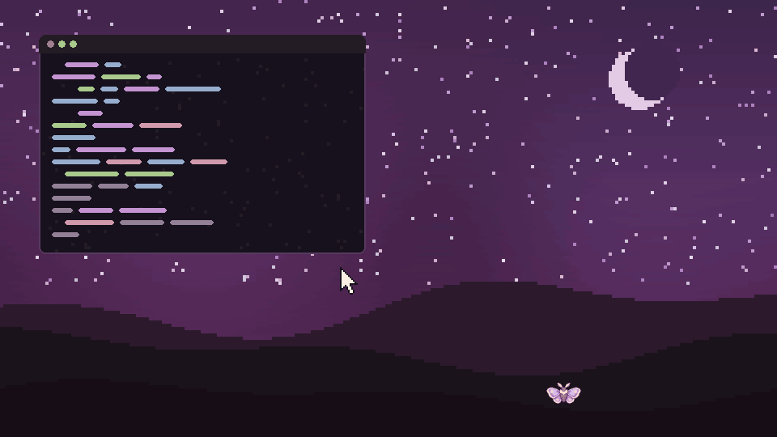
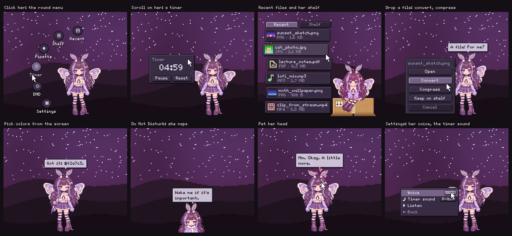
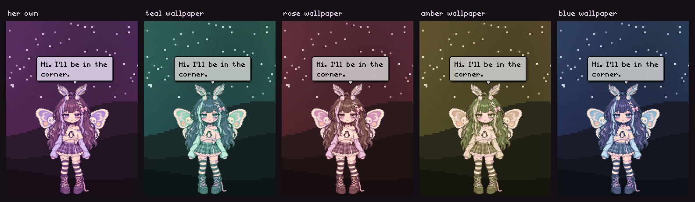

<div align="center">

# Юми

**Сонная пиксельная девочка-мотылёк, которая живёт у нижнего края экрана.**

Она прячется под краем, пока вы работаете, и выглядывает, когда нужна: держит под рукой
последние файлы, ставит таймеры, берёт цвета с экрана, конвертирует файлы, перенимает цвета
обоев и дремлет, когда вас нет рядом.



[English](README.md) · Русский

</div>

---

## Что она умеет



- **Живёт у нижнего края.** Пока она спрятана, там порхает маленький мотылёк. Наведите на
  него курсор (или нажмите свою горячую клавишу), и она вылезет.
- **Круглое меню.** Клик по ней: Недавние, Полка, Пипетка, Таймер, Анекдот, Не мешать, Настройки и до
  четырёх своих кнопок.
- **Недавние файлы и полка.** Под ней появляется коробка, из неё высыпаются последние файлы.
  Клик открывает, карточку можно перетащить в любое приложение, любимое можно положить на полку.
- **Конвертация и сжатие.** Бросьте файлы на неё: PNG ↔ JPG ↔ WebP, видео → MP4 / WebM / GIF / MP3,
  аудио → MP3 / OGG / FLAC…, или просто уменьшить размер. Прогресс видно над её головой.
- **Таймер.** Прокрутите колесо над ней, а цифры можно поправить вручную. Когда время выходит,
  дважды звучит мягкий колокольчик.
- **Пипетка.** Клик в любом месте экрана: код цвета копируется и остаётся в её истории.
- **Не мешать.** Она засыпает в одеялке и включает режим «Не беспокоить» у демона уведомлений
  (KDE Plasma, swaync, mako, dunst).
- **Цвета обоев.** Волосы, глаза, одежда, крылья и её облачка перекрашиваются под обои.
- **Живая.** Следит глазами за курсором, краснеет, когда её гладят (за курсором сыплются
  искорки), реагирует на зарядку,
  Wi-Fi, загрузки, скриншоты и музыку, дремлет, когда вас нет, и по желанию напоминает попить
  воды.
- **Праздничные наряды** со шляпками, в которых она проделала дырочки для антенок.
- **Несколько мониторов.** Её можно перенести на другой экран.
- **Голосок.** Слова печатаются с маленькими 8-битными «блипами», как у персонажей в играх
  (громкость или «выкл» в Настройки → Звук → Голосок) — а можно, чтобы она говорила по-настоящему,
  offline-голосом ([Silero](https://github.com/snakers4/silero-models), см. «Настоящий голосок»).
- **Она слушает и отвечает.** Кнопка с микрофоном на кольце: офлайн-Vosk слышит фразу (какой
  микрофон слушать — выбирается в настройках), локальная
  Ollama отвечает (модель выбирается в настройках), и она произносит ответ вслух — см. «Она слушает
  и отвечает» ниже. А ещё она просыпается от своего имени: скажи «Юми» — и она сразу слушает.
  Спроси «который час» или «какая погода» — она отвечает сама: часы всегда под рукой, а погода —
  один маленький взгляд на [wttr.in](https://wttr.in) (если в фразе названо место — она глянет
  именно туда, а не в своё окно). Погода бывает на сегодня («юми погода в ялте»), на завтра
  («юми погода на завтра в ялте») и на неделю («юми погода на неделю»); завтра и неделю
  она смотрит в [Open-Meteo](https://open-meteo.com). Свой город можно вписать в
  `~/.config/yumi/settings.json` как `"weather_city": "Ялта"` — тогда «юми погода» смотрит
  именно туда (по умолчанию там «Анапа», а `""` — погода по месту, где стоит компьютер).
- Русский и английский, язык берётся из системы.




## Где она работает

Нужен Wayland-композитор с **wlr-layer-shell**:

| Работает | Пока нет |
| --- | --- |
| sway, Hyprland, niri, river, Wayfire, labwc, KDE Plasma 6, COSMIC и другие на wlroots | GNOME (в Mutter нет layer-shell), сессии X11, Windows, macOS |

Всё, кроме самого окна, необязательно: если какой-то программы нет, она просто не делает эту
одну вещь, а в настройках, где это важно, будет написано «пока недоступно».

## Установка

### 1. Зависимости

| Дистрибутив | Команда |
| --- | --- |
| Arch, CachyOS, EndeavourOS | `sudo pacman -S --needed python-gobject python-cairo gtk4 gtk4-layer-shell` |
| Void | `sudo xbps-install -S python3-gobject python3-cairo gtk4 gtk4-layer-shell` |
| Fedora | `sudo dnf install python3-gobject python3-cairo gtk4 gtk4-layer-shell` |
| openSUSE Tumbleweed | `sudo zypper in python3-gobject python3-gobject-cairo typelib-1_0-Gtk-4_0 typelib-1_0-Gtk4LayerShell-1_0` |
| Debian 13+, Ubuntu (если пакет есть) | `sudo apt install python3-gi python3-gi-cairo gir1.2-gtk-4.0 gir1.2-gtk4layershell-1.0` |

Дополнительно, по желанию:

| Программа | Зачем |
| --- | --- |
| `ffmpeg` | конвертация и сжатие видео, аудио и GIF |
| `imagemagick`, `pngquant`, `oxipng`, `jpegoptim` | конвертация и сжатие картинок |
| `hyprpicker` или `grim` + `slurp` | пипетка на wlroots (в KDE и COSMIC работает через портал) |
| `wl-clipboard` | копирование цветов (иначе через буфер GTK) |
| `swayidle` | дремать, когда вас нет |
| `playerctl` | реакция на музыку |
| `networkmanager` (`nmcli`) | реакции на Wi-Fi |
| `swaync`, `mako` или `dunst` | «Не мешать» (KDE Plasma ничего дополнительно не нужно) |
| `pipewire` (`pw-play`), `paplay`, `aplay` или `ffplay` | звук таймера |
| `tools/tts_setup.sh` (окружение с torch, ~450 МБ) | настоящий голосок: локальный Silero TTS |
| `tools/stt_setup.sh` (маленькое окружение с vosk) | ушки: локальное распознавание речи |

### 2. Сама Юми

```sh
git clone https://github.com/lamex30/yumi
cd yumi
./install.sh          # в ~/.local; для всех: sudo PREFIX=/usr/local ./install.sh
yumi
```

Можно запускать и прямо из папки: `./bin/yumi`. Удалить: `./install.sh --uninstall`.
Для сборщиков пакетов в [`packaging/`](packaging) лежат `PKGBUILD` и `template` для Void.

**NixOS:** `nix run github:lamex30/yumi` — попробовать; чтобы установить, добавь flake во входы и
положи `inputs.yumi.packages.${system}.default` в `environment.systemPackages` (или возьми
`overlays.default` и `pkgs.yumi-moth`). Зависимости и gtk4-layer-shell подключены. На более старой NixOS добавь
`inputs.yumi.inputs.nixpkgs.follows = "nixpkgs";`, чтобы она использовала те же библиотеки, что и система.

### 3. Автозапуск и горячая клавиша

`yumi` запускает её в фоне: терминал можно закрыть, она останется. `yumi --toggle` достаёт её,
прячет, а в режиме «Не мешать» открывает меню. Ещё есть `--pipette`, `--recent`, `--sleep` («Не мешать»), `--home`,
`--monitor`, `--quit` и `--foreground`, чтобы она осталась привязана к терминалу (для отладки). Примеры для sway, Hyprland, niri, river,
Wayfire, labwc, KDE и COSMIC есть в [английском README](README.md#3-start-her-with-your-session-and-give-her-a-hotkey).
Для sway:

```
exec yumi
bindsym $mod+z exec yumi --toggle
bindsym $mod+p exec yumi --pipette
```

## Как с ней обращаться

| Действие | Что она делает |
| --- | --- |
| Навести на мотылька | вылезает, мотылёк прячется за неё |
| Клик по ней | круглое меню: Недавние, Полка, Пипетка, Таймер, Анекдот, Не мешать, Настройки |
| Недавние / Полка | под ней появляется коробка, рядом высыпаются файлы |
| Клик по карточке / вытащить её | открыть / бросить в любое приложение |
| Карточку на неё или правый клик | Открыть, Конвертировать, Сжать, На полку |
| Бросить файлы на неё (или на мотылька) | спросит, что сделать |
| Колесо над ней | таймер; стартует, когда перестанете крутить |
| Клик по цифрам таймера | ввод времени с клавиатуры, Enter применяет, Esc отменяет |
| Зажать и потянуть | берёт её за шкирку |
| Отпустить у нижнего края | прячется там, в любом месте края |
| Отпустить в другом месте | висит в воздухе и машет крыльями, пока не уберёте |
| Средний клик (или Настройки → Поведение → Не прятаться) | перестаёт прятаться; ещё раз, чтобы снова пряталась |
| Двойной клик | возвращается в правый нижний угол |
| Погладить по голове (поводить курсором туда-сюда) | краснеет, сердечки и искорки за курсором |
| Не мешать | режим «Не беспокоить»; спит в одеялке и молчит. Если навести курсор или пользоваться ею, приоткрывает глаза, а режим не выключается. Разбудить можно через меню |

Настройки разложены по группам: **Поведение** (не прятаться, реакции на систему, болтовня,
дремать без тебя, перерывы каждые 20 / 30 / 45 / 60 минут: вода, глаза, разминка), **Звук**
(громкость голоска, тип голоска, звук таймера: её колокольчик или любой аудиофайл), **Её ушки**
(микрофон, точность ушей, будить по «Юми»), **Внешний вид** (цвета от
обоев или вручную, наряд, на каком экране она живёт) и **Язык**. Там же можно снова посмотреть
знакомство.

## Цвета

Она берёт оттенок обоев и меняется вместе с ними. Обои она находит сама:

- **демоны обоев:** awww / swww, swaybg, hyprpaper, wpaperd;
- **конфиги:** waypaper, azote, KDE Plasma, COSMIC, кэш pywal;
- **файл палитры**, который пишет ваш скрипт темы: `~/.config/yumi/palette.json`, либо просто
  `{"hue": 0.47}` (0…1), либо полная палитра с `bg`, `surface`, `fg`, `accent`… (тогда и облачка
  в цвет). Также читается `~/.config/pastel-rice/palette.json`.

Если ничего не нашлось, у «Цвета от обоев» будет «пока недоступно», а цвет можно выбрать вручную.

## Настоящий голосок

Кроме 8-битных «блипов» она умеет говорить по-настоящему, полностью офлайн: локальный
[Silero](https://github.com/snakers4/silero-models)-синтез на вашей же машине (русские голоса
`kseniya`, `baya`, `xenia`…, английские `en_0`…, язык реплики выбирается сам). Нужны Python
3.10–3.13 и ~450 МБ на диске; всё живёт в своём venv и ничего не трогает в системе:

```sh
./tools/tts_setup.sh
```

Потом у неё: **Настройки → Звук → Тип голоска → Настоящий**. Первая фраза займёт секунды — голоса
прогреваются в фоне, дальше она отвечает сразу, а реплики кэшируются в `~/.cache/yumi/tts`. Сделать
голос выше и мимимишнее можно в `~/.config/yumi/tts.json`:

```json
{"ru_speaker": "kseniya", "en_speaker": "en_0", "pitch": 1.15}
```

`pitch` — 1.0 как записано, 1.2 уже пищалка. После правки файла перезапустите голос:
`pkill -f yumi/tts_daemon.py`. Если ничего не настраивать, останется пищалка — как раньше.

## Она слушает и отвечает

Кнопка с микрофоном на её кольце (**Послушать**) заставляет её слушать: нажмите, скажите фразу,
ещё раз — чтобы она не ждала дальше. Речь распознаётся полностью офлайн: фразу читает локальный
[faster-whisper](https://github.com/SYSTRAN/faster-whisper) (маленький whisper на CPU), а локальный
[Vosk](https://github.com/alphacep/vosk-api) слышит, где фраза кончилась (и ждёт её имя — «Юми,
...»). Обе модели скачаются сами при первых слушаниях: маленькая vosk (~45 МБ, русская и
английская) и маленькая whisper (~460 МБ — понимает куда лучше своего размера).
Услышанное она покажет в пузыре, а ответит
локальная [Ollama](https://ollama.com) (по умолчанию `lakomoor/vikhr-llama-3.2-1b-instruct:1b`);
ответ появится в пузыре и прозвучит её голоском (см. «Настоящий голосок» выше — с Silero она
говорит по-русски вслух). Последние пять реплик она помнит до выхода. Как настроить уши:

```sh
./tools/stt_setup.sh
```

vosk и faster-whisper ставятся в свой маленький venv; микрофон читается тем, что есть на рабочем
столе (`parecord`, `pw-record` или `arecord`). Если микрофонов несколько, слушать она будет тот, что вы выбрали: **Настройки → Её ушки →
Микрофон** — список подсказывает рабочий стол, а «авто» оставляет выбор за ним. Если слышит
плохо, есть ухо поточнее: **Настройки → Её ушки → Точность ушей → Точная** — whisper
вырастает до `large-v3` (~3 ГБ, скачается сама при первом слушании), vosk приносит и свою
большую русскую модель; обе понимают речь заметно лучше маленьких, цена — память и подольше
первая фраза. Дальность ушей — **Настройки → Её ушки → Дальность ушек** (Близко / Обычно /
Через комнату): это порог шумового гейта, он решает, чья речь считается голосом. «Близко»
режет тихий голос из другого конца комнаты (шёпот у экрана уже не услышит), «Через комнату»
пропускает даже тихое. Настоящая дальность — в самом микрофоне: ползунок входа в настройках
звука и направленность микрофона решают больше любого гейта. Модель ответов выбирается в
**Настройки → Её мозги → Модель ответов** (клик листает установленные); адрес Ollama живёт
в `~/.config/yumi/settings.json` как `ollama_url`.
**Настройки → Её ушки → Дневник ушек** — пока включено, она пишет всё, что слышит, в `/tmp/yumi`:
звук в файлы `ears-*.wav` (каждый не больше 10 МБ и десяти минут, на полке только пять свежих)
и услышанные фразы в `recogn.txt` строчками «время - фраза» (свежая тысяча строк, старые
выцветают). Это её отдельный тихий поток: слушание по кнопке и «Юми» работают как всегда.
Учтите, что `/tmp` на многих системах живёт в памяти, а пять файлов по 10 МБ — это ~50 МБ.

Перед моделями звук приводится в порядок: фильтр высоких частот (гул уходит), шумовой гейт,
следящий за комнатой (вентиляторы и шипение умирают), и детектор голоса (`webrtcvad`,
ставится `stt_setup.sh`, но и без него живёт) — он слышит, где фраза кончилась на самом деле,
и на ленту целиком она уходит к whisper.
На PipeWire или PulseAudio сверху работает ещё и эхоподавление webrtc (как получится,
`pactl` поднимает `module-echo-cancel` поверх выбранного микрофона): собственный голос,
проигранный в echo-sink, вычитается из того, что слышат ушки, — она не слышит сама себя.

**Время и погода.** «Который час» и «what time is it» она отвечает сама, без всяких мозгов —
просто смотрит на часы. «Какая погода» и «what's the weather» — она выглядывает на
[wttr.in](https://wttr.in) (только этот один маленький взгляд требует интернет; всё остальное
остаётся офлайн, как и раньше). Если место названо в фразе («какая погода в Москве»), смотрит
туда, иначе — в своё окно: город, где вы, распознаётся по сети. «Расскажи анекдот»
(или «tell me a joke») — она просит свою нейронку сочинить шутку и рассказывает её вслух.

**Wakeword.** Скажи «Юми» — и она сразу слушает дальше, без всяких кнопок. Имя может быть
сказано через слово («ну, Юми») и даже через полууслышанную кашу из слогов — она его
выцепляет, так что с первого раза зовёт всё чаще. Если после имени
идёт фраза («Юми, какие сегодня новости»), она ждёт её окончания, и вопрос уходит к ней целиком;
если после имени пауза — она тут же спрашивает «Да? Что ты хотел?» и слушает ответ. Ждёт она
вполголоса всегда, пока включено (выключается в **Настройки → Её ушки → Будить по «Юми»**), и при
этом не подслушивает: пока она дремлет в «Не мешать», отвечает или слушает по кнопке, имя
игнорируется. Имя не берётся с первого слова: когда буквы vosk'а вроде бы складываются в имя,
лента последних секунд уходит к whisper на «да» или «нет» — имя, наполовину услышанное из
потока видео, остаётся сном (подтверждение стоит мгновения; vosk слушает, пока whisper читает).
Микрофон при ожидании имени не распознаёт ничего лишнего: всё считается на месте,
офлайн.

## Свои кнопки, наряды, файлы

- **Кнопки:** Настройки → Кнопки сразу открывает редактор на кольце. Кнопку можно перетащить. У встроенных
  есть тумблер, удалить их нельзя («Настройки» можно только двигать). У своих есть минус, а клик по такой
  кнопке открывает её редактирование. Полый кружок с плюсом добавляет новую: команда, название, иконка из
  списка или своя картинка. Свои кнопки хранятся в `~/.config/yumi/actions.json`, файл можно править вручную.
- **Наряды:** Настройки → Внешний вид → Наряд: «авто» по календарю (Хэллоуин 24.10–2.11, Новый год 15.12–10.01,
  День святого Валентина 12–15.02, 8 Марта 6–9.03), любой вручную или «нет». Как сделать свой
  наряд, написано в [английском README](README.md#outfits).
- **Файлы:** настройки в `~/.config/yumi/settings.json`, положение, полка и цвета в
  `~/.local/state/yumi/state.json`, кэш озвученных реплик в `~/.cache/yumi/tts`, порт ушек
  в `~/.cache/yumi/stt`.
  `YUMI_SCALE=2 yumi` рисует её в два раза крупнее.

## Если что-то не так

- **`gtk4-layer-shell is not installed`**: поставьте его (см. таблицу выше) или укажите путь:
  `YUMI_LAYER_SHELL_LIB=/путь/к/libgtk4-layer-shell.so.0 yumi`.
- **«this desktop has no wlr-layer-shell»**: у вас GNOME или X11, они пока не поддерживаются.
- **«Цвета от обоев: пока недоступно»**: она не знает вашу программу для обоев. Запишите оттенок в
  `~/.config/yumi/palette.json` или откройте issue и напишите, чем вы ставите обои.
- **Она не появляется**: запустите `yumi --foreground` и посмотрите, что она пишет, или загляните
  в `~/.local/state/yumi/yumi.log`.
- **Не дремлет, когда вас нет**: поставьте `swayidle`.

## Лицензия

[MIT](LICENSE)
