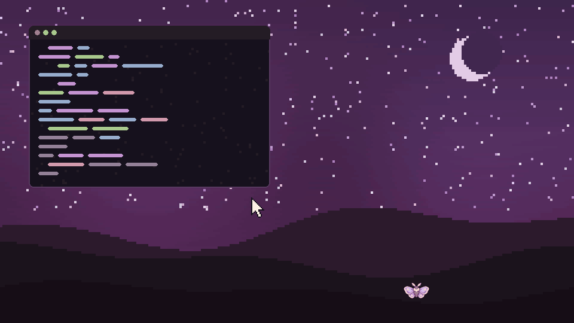
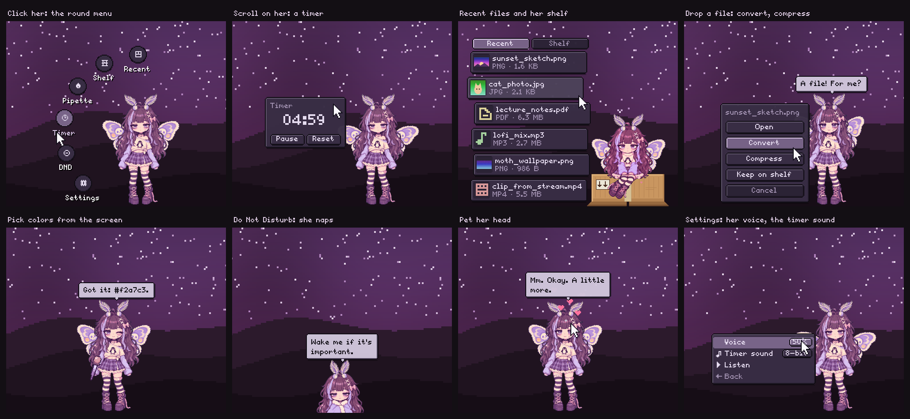
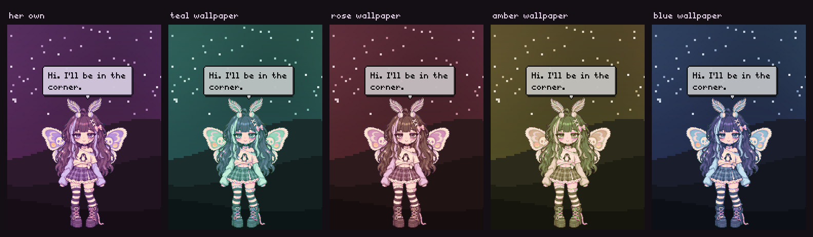
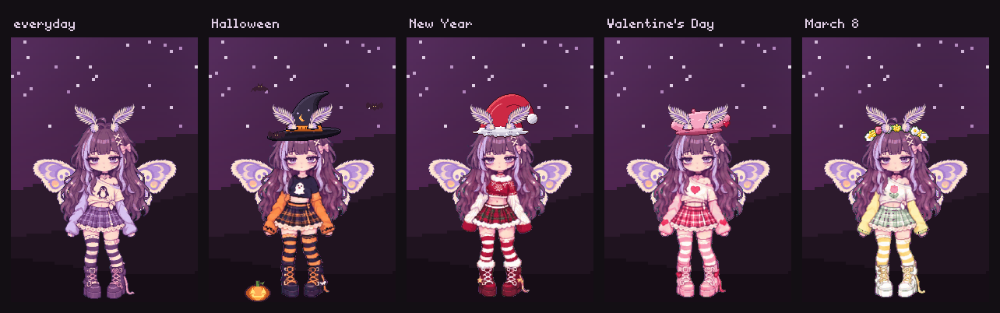

<div align="center">

# Юми

**Сонная пиксельная девочка-мотылёк, которая живёт у нижнего края экрана.**

Она прячется под краем, пока вы работаете, и выглядывает, когда нужна: держит под рукой
последние файлы, ставит таймеры, берёт цвета с экрана, конвертирует файлы, перенимает цвета
обоев и дремлет, когда вас нет рядом.



[English](README.md) · Русский

</div>

---

## Что она умеет



- **Живёт у нижнего края.** Пока она спрятана, там порхает маленький мотылёк. Наведите на
  него курсор (или нажмите свою горячую клавишу), и она вылезет.
- **Круглое меню.** Клик по ней: Недавние, Полка, Пипетка, Таймер, Не мешать, Настройки и до
  четырёх своих кнопок.
- **Недавние файлы и полка.** Под ней появляется коробка, из неё высыпаются последние файлы.
  Клик открывает, карточку можно перетащить в любое приложение, любимое можно положить на полку.
- **Конвертация и сжатие.** Бросьте файлы на неё: PNG ↔ JPG ↔ WebP, видео → MP4 / WebM / GIF / MP3,
  аудио → MP3 / OGG / FLAC…, или просто уменьшить размер. Прогресс видно над её головой.
- **Таймер.** Прокрутите колесо над ней, а цифры можно поправить вручную. Когда время выходит,
  дважды звучит мягкий колокольчик.
- **Пипетка.** Клик в любом месте экрана: код цвета копируется и остаётся в её истории.
- **Не мешать.** Она засыпает в одеялке и включает режим «Не беспокоить» у демона уведомлений
  (swaync, mako, dunst).
- **Цвета обоев.** Волосы, глаза, одежда, крылья и её облачка перекрашиваются под обои.
- **Живая.** Следит глазами за курсором, краснеет, когда её гладят (за курсором сыплются
  искорки), реагирует на зарядку,
  Wi-Fi, загрузки, скриншоты и музыку, дремлет, когда вас нет, и по желанию напоминает попить
  воды.
- **Праздничные наряды** со шляпками, в которых она проделала дырочки для антенок.
- **Несколько мониторов.** Её можно перенести на другой экран.
- **Голосок.** Слова печатаются с маленькими 8-битными «блипами», как у персонажей в играх
  (громкость или «выкл» в Настройки → Звук → Голосок).
- Русский и английский, язык берётся из системы.





## Где она работает

Нужен Wayland-композитор с **wlr-layer-shell**:

| Работает | Пока нет |
| --- | --- |
| sway, Hyprland, niri, river, Wayfire, labwc, KDE Plasma 6, COSMIC и другие на wlroots | GNOME (в Mutter нет layer-shell), сессии X11, Windows, macOS |

Всё, кроме самого окна, необязательно: если какой-то программы нет, она просто не делает эту
одну вещь, а в настройках, где это важно, будет написано «пока недоступно».

## Установка

### 1. Зависимости

| Дистрибутив | Команда |
| --- | --- |
| Arch, Manjaro, EndeavourOS | `sudo pacman -S --needed python-gobject python-cairo gtk4 gtk4-layer-shell` |
| Void | `sudo xbps-install -S python3-gobject python3-cairo gtk4 gtk4-layer-shell` |
| Fedora | `sudo dnf install python3-gobject python3-cairo gtk4 gtk4-layer-shell` |
| openSUSE Tumbleweed | `sudo zypper in python3-gobject python3-gobject-cairo typelib-1_0-Gtk-4_0 typelib-1_0-Gtk4LayerShell-1_0` |
| Debian 13+, Ubuntu (если пакет есть) | `sudo apt install python3-gi python3-gi-cairo gir1.2-gtk-4.0 gir1.2-gtk4layershell-1.0` |

Дополнительно, по желанию:

| Программа | Зачем |
| --- | --- |
| `ffmpeg` | конвертация и сжатие видео, аудио и GIF |
| `imagemagick`, `pngquant`, `oxipng`, `jpegoptim` | конвертация и сжатие картинок |
| `hyprpicker` или `grim` + `slurp` | пипетка на wlroots (в KDE и COSMIC работает через портал) |
| `wl-clipboard` | копирование цветов (иначе через буфер GTK) |
| `swayidle` | дремать, когда вас нет |
| `playerctl` | реакция на музыку |
| `networkmanager` (`nmcli`) | реакции на Wi-Fi |
| `swaync`, `mako` или `dunst` | «Не мешать» |
| `pipewire` (`pw-play`), `paplay`, `aplay` или `ffplay` | звук таймера |

### 2. Сама Юми

```sh
git clone https://github.com/lamex30/yumi
cd yumi
./install.sh          # в ~/.local; для всех: sudo PREFIX=/usr/local ./install.sh
yumi
```

Можно запускать и прямо из папки: `./bin/yumi`. Удалить: `./install.sh --uninstall`.
Для сборщиков пакетов в [`packaging/`](packaging) лежат `PKGBUILD` и `template` для Void.

### 3. Автозапуск и горячая клавиша

`yumi` запускает её в фоне: терминал можно закрыть, она останется. `yumi --toggle` достаёт её,
прячет или будит. Ещё есть `--pipette`, `--recent`, `--sleep` («Не мешать»), `--home`,
`--monitor`, `--quit` и `--foreground`, чтобы она осталась привязана к терминалу (для отладки). Примеры для sway, Hyprland, niri, river,
Wayfire, labwc, KDE и COSMIC есть в [английском README](README.md#3-start-her-with-your-session-and-give-her-a-hotkey).
Для sway:

```
exec yumi
bindsym $mod+z exec yumi --toggle
bindsym $mod+p exec yumi --pipette
```

## Как с ней обращаться

| Действие | Что она делает |
| --- | --- |
| Навести на мотылька | вылезает, мотылёк прячется за неё |
| Клик по ней | круглое меню: Недавние, Полка, Пипетка, Таймер, Не мешать, Настройки |
| Недавние / Полка | под ней появляется коробка, рядом высыпаются файлы |
| Клик по карточке / вытащить её | открыть / бросить в любое приложение |
| Карточку на неё или правый клик | Открыть, Конвертировать, Сжать, На полку |
| Бросить файлы на неё (или на мотылька) | спросит, что сделать |
| Колесо над ней | таймер; стартует, когда перестанете крутить |
| Клик по цифрам таймера | ввод времени с клавиатуры, Enter применяет, Esc отменяет |
| Зажать и потянуть | берёт её за шкирку |
| Отпустить у нижнего края | прячется там, в любом месте края |
| Отпустить в другом месте | висит в воздухе и машет крыльями, пока не уберёте |
| Средний клик (или Настройки → Поведение → Не прятаться) | перестаёт прятаться; ещё раз, чтобы снова пряталась |
| Двойной клик | возвращается в правый нижний угол |
| Погладить по голове (поводить курсором туда-сюда) | краснеет, сердечки и искорки за курсором |
| Не мешать | режим «Не беспокоить»; спит в одеялке и молчит |

Настройки разложены по группам: **Поведение** (не прятаться, реакции на систему, болтовня,
дремать без тебя, перерывы каждые 20 / 30 / 45 / 60 минут: вода, глаза, разминка), **Звук**
(громкость голоска, звук таймера: её колокольчик или любой аудиофайл), **Внешний вид** (цвета от
обоев или вручную, наряд, на каком экране она живёт) и **Язык**. Там же можно снова посмотреть
знакомство.

## Цвета

Она берёт оттенок обоев и меняется вместе с ними. Обои она находит сама:

- **демоны обоев:** awww / swww, swaybg, hyprpaper, wpaperd;
- **конфиги:** waypaper, azote, KDE Plasma, COSMIC, кэш pywal;
- **файл палитры**, который пишет ваш скрипт темы: `~/.config/yumi/palette.json`, либо просто
  `{"hue": 0.47}` (0…1), либо полная палитра с `bg`, `surface`, `fg`, `accent`… (тогда и облачка
  в цвет). Также читается `~/.config/pastel-rice/palette.json`.

Если ничего не нашлось, у «Цвета от обоев» будет «пока недоступно», а цвет можно выбрать вручную.

## Свои кнопки, наряды, файлы

- **Свои кнопки:** скопируйте [`actions.example.json`](actions.example.json) в
  `~/.config/yumi/actions.json` (до 4 штук).
- **Наряды:** Настройки → Внешний вид → Наряд: «авто» по календарю (Хэллоуин 24.10–2.11, Новый год 15.12–10.01,
  День святого Валентина 12–15.02, 8 Марта 6–9.03), любой вручную или «нет». Как сделать свой
  наряд, написано в [английском README](README.md#outfits).
- **Файлы:** настройки в `~/.config/yumi/settings.json`, положение, полка и цвета в
  `~/.local/state/yumi/state.json`. `YUMI_SCALE=2 yumi` рисует её в два раза крупнее.

## Если что-то не так

- **`gtk4-layer-shell is not installed`**: поставьте его (см. таблицу выше) или укажите путь:
  `YUMI_LAYER_SHELL_LIB=/путь/к/libgtk4-layer-shell.so.0 yumi`.
- **«this desktop has no wlr-layer-shell»**: у вас GNOME или X11, они пока не поддерживаются.
- **«Цвета от обоев: пока недоступно»**: она не знает вашу программу для обоев. Запишите оттенок в
  `~/.config/yumi/palette.json` или откройте issue и напишите, чем вы ставите обои.
- **Она не появляется**: запустите `yumi --foreground` и посмотрите, что она пишет, или загляните
  в `~/.local/state/yumi/yumi.log`.
- **Не дремлет, когда вас нет**: поставьте `swayidle`.

## Лицензия

[MIT](LICENSE)
