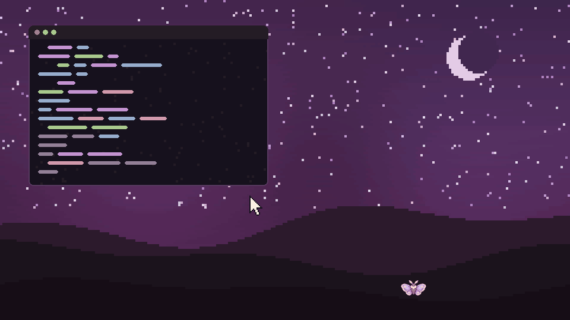

The first release of Yumi, a sleepy pixel-art moth girl who lives at the bottom of your
Wayland screen. 🦋

**What she does:** hides under the screen edge (a tiny moth marks the spot), a round menu with
recent files and a shelf, convert / compress by dropping files on her, a scroll-to-set timer,
a screen color picker, Do Not Disturb naps, health-break reminders, petting, eyes that follow
your pointer, seasonal outfits with hats, and colors that follow your wallpaper.

**Runs on** sway, Hyprland, niri, river, Wayfire, labwc, KDE Plasma 6, COSMIC and other
compositors with wlr-layer-shell. GNOME and X11 are not supported yet.

**Install:** see the [README](https://github.com/lamex30/yumi#install). In short: install
`python-gobject gtk4 gtk4-layer-shell`, clone, `./install.sh`, run `yumi`, bind
`yumi --toggle` to a key.
